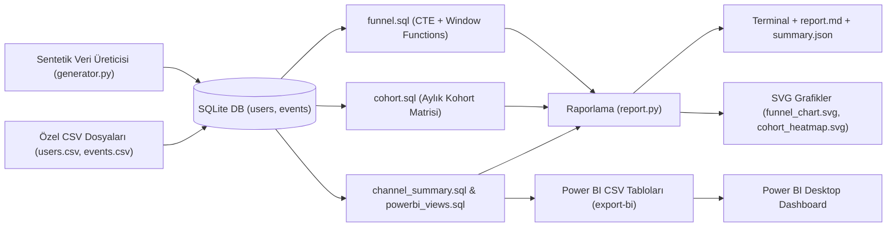
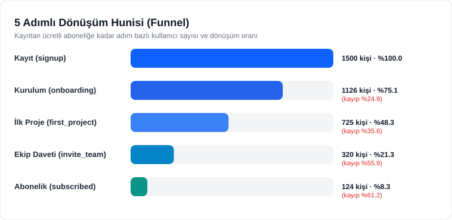
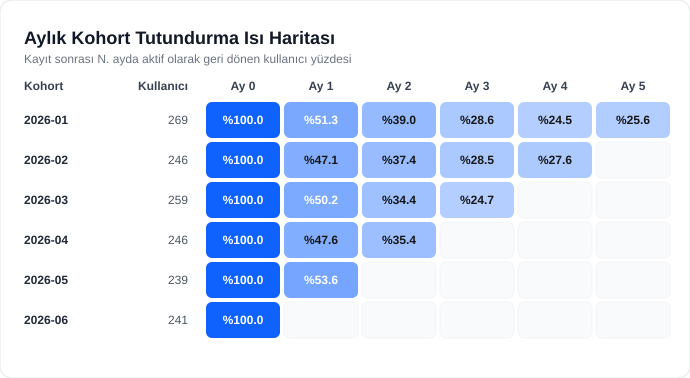

# Kohort Tutundurma & Dönüşüm Hunisi Analizi (Python + SQLite)

[](https://github.com/bugracangl/cohort-funnel-sql/actions/workflows/tests.yml)
[](https://www.python.org/downloads/)
[](https://www.sqlite.org/)
[](#)
[](LICENSE)
[](https://bugracangl.github.io/cohort-funnel-sql/)

**Python** ve **SQLite** kullanarak sıfır harici bağımlılıkla çalışan ürün analitiği projesi. Tek komutla örnek kullanıcı ve olay (event) verisi üretir, analitik SQL sorgularını çalıştırır ve hem terminal tablosu hem de görsel raporlar oluşturur:

1. **5 Adımlı Kronolojik Dönüşüm Hunisi (Funnel):** Zincirlenmiş CTE'ler ve pencere fonksiyonları (`FIRST_VALUE`, `LAG`) ile `signup -> onboarding_complete -> first_project -> invite_team -> subscribed` adımlarındaki dönüşüm ve kayıp oranlarını hesaplar.
2. **Aylık Kohort Tutundurma Matrisi (Cohort Retention):** Kullanıcıların kayıt oldukları aya göre sonraki aylarda (`Ay 0`, `Ay 1`, ..., `Ay N`) geri dönüş oranlarını çıkarır.
3. **Edinme Kanalı Performansı:** `referral`, `organic`, `paid_search` ve `social` kanallarının aktivasyon ve ücretli abonelik dönüşümlerini karşılaştırır.
4. **Otomatik Çıktılar:** Terminal özeti, Markdown raporu (`report.md`), JSON özeti (`summary.json`) ve saf Python ile üretilen Türkçe **SVG grafikleri**.

> [!NOTE]
> **Veri Seti ve Şeffaflık Notu:** Bu projedeki veritabanı (`data/analytics.db`) gerçek kullanıcı verisi içermez. `src/cohort_funnel/generator.py` modülü, gerçekçi SaaS ürün davranışlarını (adım bazlı dönüşüm, kanal farkları ve aylık tutundurma düşüşünü) simüle etmek üzere **yapay zekâ desteğiyle** tasarlanmış **sentetik bir veri üreticisi** tarafından oluşturulmaktadır. Dilerseniz `load` komutuyla kendi gerçek `users.csv` ve `events.csv` verilerinizi yükleyerek aynı SQL analizlerini çalıştırabilirsiniz.

---

## Mimari ve Veri Akışı



---

## Örnek Çıktılar





<details>
<summary>Örnek Terminal Raporunu Göster (1.500 kullanıcı, 6.543 olay)</summary>

```text
==================================================================================
ÜRÜN ANALİTİĞİ RAPORU (PYTHON + SQLITE)
==================================================================================

1. DÖNÜŞÜM HUNİSİ (FUNNEL)
Adım                            Kişi    Genel %    Adım %   Kayıp %  Görsel
----------------------------------------------------------------------------------
Kayıt (signup)                  1500    100.00%   100.00%     0.00%  [##################]
Kurulum (onboarding)            1126     75.07%    75.07%    24.93%  [##############....]
İlk Proje (first_project)        725     48.33%    64.39%    35.61%  [#########.........]
Ekip Daveti (invite_team)        320     21.33%    44.14%    55.86%  [####..............]
Abonelik (subscribed)            124      8.27%    38.75%    61.25%  [##................]

2. AYLIK KOHORT TUTUNDURMA MATRİSİ (COHORT RETENTION)
Kohort       Kişi    Ay 0    Ay 1    Ay 2    Ay 3    Ay 4    Ay 5
-----------------------------------------------------------------
2026-01       269  100.0%   51.3%   39.0%   28.6%   24.5%   25.6%
2026-02       246  100.0%   47.1%   37.4%   28.5%   27.6%       -
2026-03       259  100.0%   50.2%   34.4%   24.7%       -       -
2026-04       246  100.0%   47.6%   35.4%       -       -       -
2026-05       239  100.0%   53.6%       -       -       -       -
2026-06       241  100.0%       -       -       -       -       -

3. EDİNME KANALI PERFORMANSI
Kanal          Kullanıcı   Kurulum    Aktif  Ücretli   Akt. %   Ücr. %
----------------------------------------------------------------------------------
referral             307       261      202       51   65.80%   16.61%
organic              508       392      274       48   53.94%    9.45%
social               263       168       72       11   27.38%    4.18%
paid_search          422       305      177       14   41.94%    3.32%
==================================================================================
```

</details>

---

## Proje Yapısı

```text
cohort-funnel-sql/
├── .github/workflows/
│   └── tests.yml                # GitHub Actions otomatik test akışı
├── assets/
│   ├── funnel_chart.svg         # Örnek dönüşüm hunisi SVG grafiği
│   └── cohort_heatmap.svg       # Örnek kohort tutundurma SVG ısı haritası
├── sql/
│   ├── schema.sql               # İlişkisel şema (users, events) ve indeksler
│   ├── funnel.sql               # Kronolojik 5 adımlı funnel sorgusu
│   ├── cohort.sql               # Aylık kohort tutundurma matrisi sorgusu
│   ├── channel_summary.sql      # Edinme kanalı performans sorgusu
│   └── powerbi_views.sql        # Power BI için hazır SQL VIEW katmanı
├── powerbi/
│   └── README.md                # Power BI Desktop adım adım kurulum rehberi
├── src/cohort_funnel/
│   ├── db.py                    # SQLite bağlantı yönetimi, şema kurulumu ve CSV yükleyici
│   ├── generator.py             # Tekrarlanabilir (seed) sentetik SaaS veri üreticisi
│   ├── analyzer.py              # .sql dosyalarını çalıştıran Python analiz katmanı
│   ├── powerbi.py               # SQL VIEW'larını Power BI CSV'lerine aktaran modül
│   ├── report.py                # Terminal tablosu, Markdown ve SVG grafik üreticisi
│   └── cli.py                   # Komut satırı arayüzü (demo, generate, load, analyze, export-bi)
├── tests/
│   └── test_analytics.py        # SQL mantığı, CSV yükleme ve CLI birim testleri
├── demo_baslat.bat              # Windows için tek tıkla demo ve grafik açıcı
└── pyproject.toml
```

---

## Hızlı Başlangıç

Hiçbir ek paket (`pip install`) gerekmez; yalnızca Python 3.10+ yeterlidir.

* **Windows'ta en kolay yol:** [demo_baslat.bat](demo_baslat.bat) dosyasına çift tıklayın; veritabanını oluşturur, analizi çalıştırır ve grafikleri otomatik açar.

Terminal üzerinden çalıştırmak için:

```powershell
# 1. Repoyu klonlayın
git clone https://github.com/bugracangl/cohort-funnel-sql.git
cd cohort-funnel-sql

# 2. Demoyu çalıştırın (Windows PowerShell)
$env:PYTHONPATH = "src"
python -m cohort_funnel.cli demo
```

macOS / Linux üzerinde:

```bash
PYTHONPATH=src python3 -m cohort_funnel.cli demo
```

Bu komut yerel bir SQLite veritabanı (`data/analytics.db`) oluşturur, 6 aya yayılmış 1.500 sentetik kullanıcı ve olay verisi ekler, SQL sorgularını çalıştırır ve şu dosyaları üretir:
- `output/report.md`
- `output/funnel_chart.svg`
- `output/cohort_heatmap.svg`
- `output/summary.json`
- `output/powerbi/*.csv` (Power BI Desktop için hazır 6 tablo — kurulum için [powerbi/README.md](powerbi/README.md) dosyasına bakın)

---

## Diğer CLI Komutları

```bash
# Kanal veya tarih aralığına göre filtreleyerek analiz et
python -m cohort_funnel.cli analyze --db data/analytics.db --channel referral --out-dir output

# Power BI Desktop için SQL VIEW tablolarını CSV olarak dışa aktar
python -m cohort_funnel.cli export-bi --db data/analytics.db --out-dir output/powerbi

# Sentetik veri ile birlikte CSV dosyalarını da dışa aktar
python -m cohort_funnel.cli generate --users 2000 --months 6 --csv-dir data/csv

# Kendi CSV verilerini SQLite'a yükle
python -m cohort_funnel.cli load --db data/custom.db --users-csv users.csv --events-csv events.csv --reset
```

### Beklenen CSV Formatı

**`users.csv`**
```csv
user_id,signup_date,channel,plan_tier
usr_00001,2026-01-05,organic,pro
```

**`events.csv`**
```csv
user_id,event_name,event_ts
usr_00001,signup,2026-01-05T10:12:00
usr_00001,onboarding_complete,2026-01-05T10:25:00
```

---

## SQL Tasarım Notları

- **Kronolojik Sıralı Funnel (`sql/funnel.sql`):** Her adım bir önceki adımın CTE'sine bağlanır ve `e.event_ts >= prev.ts` koşulunu zorunlu kılar. Böylece sırasız gerçekleşen olaylar sonraki adımları şişirmez; genel ve adım bazlı dönüşüm oranları doğrudan SQL içinde `FIRST_VALUE()` ve `LAG()` ile hesaplanır.
- **Yıl Geçişine Dayanıklı Kohort Farkı (`sql/cohort.sql`):** Ay farkını `(yıl_farkı * 12 + ay_farkı)` formülüyle hesaplar; bu sayede yıl atlayan kohortlar (ör. `2025-12` -> `2026-01`) hatasız gruplanır.

---

## Testleri Çalıştırma

```powershell
$env:PYTHONPATH = "src"
python -m unittest discover -s tests -v
```

```bash
PYTHONPATH=src python3 -m unittest discover -s tests -v
```

---

## 🌐 Canlı Dashboard (GitHub Pages)

Projenin interaktif dashboard'u GitHub Pages üzerinden yayınlanmıştır:

**[https://bugracangl.github.io/cohort-funnel-sql/](https://bugracangl.github.io/cohort-funnel-sql/)**

> `index.html` dosyası (kopya `dashboard.html`) repo kökündedir; GitHub Pages bunu otomatik olarak kök sayfa olarak sunar.

---

## 📊 Power BI Desktop Bağlantısı

Bu proje Power BI Desktop entegrasyonu için hazır SQL VIEW katmanı ve CSV çıktıları içerir.

**SQL VIEW'ları Görüntüle / CSV Dışa Aktar:**
```bash
# SQL VIEW tanımlarını incele
cat sql/powerbi_views.sql

# Power BI için CSV tabloları üret (6 tablo)
python -m cohort_funnel.cli export-bi --db data/analytics.db --out-dir output/powerbi
```

**Power BI Desktop'ta Bağlantı:**
1. Power BI Desktop → **Veri Al** → **Metin/CSV** → `output/powerbi/` klasöründeki 6 `.csv` dosyasını seçin
2. Alternatif: **SQL Server** bağlayıcısı ile `sql/powerbi_views.sql` içindeki VIEW tanımlarını kopyalayıp Power BI'da **Boş Sorgu** → **Gelişmiş Düzenleyici** ile yapıştırın
3. Tablolar: `bi_huni_genel`, `bi_huni_kanal`, `bi_kohort_genel`, `bi_kohort_kanal`, `bi_kanal_ozet`, `bi_kanal_huni_adim`

---

## ⚠️ Dürüstlük ve Şeffaflık Notu

> **Not:** Bu proje tamamen yapay (sentetik) verilerle oluşturulmuş olup, Claude ve Antigravity araçlarının yardımıyla geliştirilen bir deneme ve portföy projesidir.
